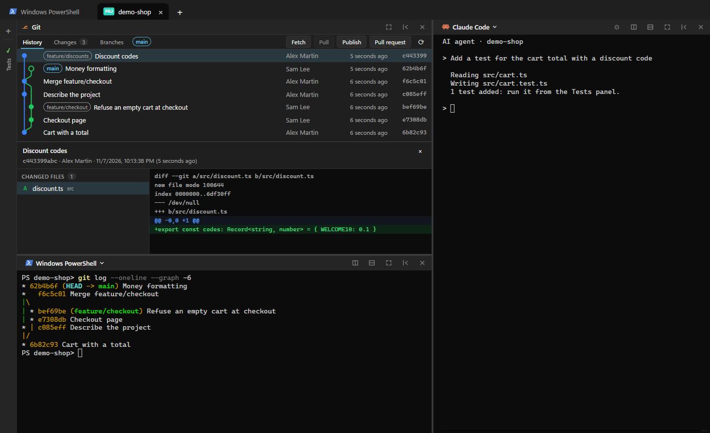
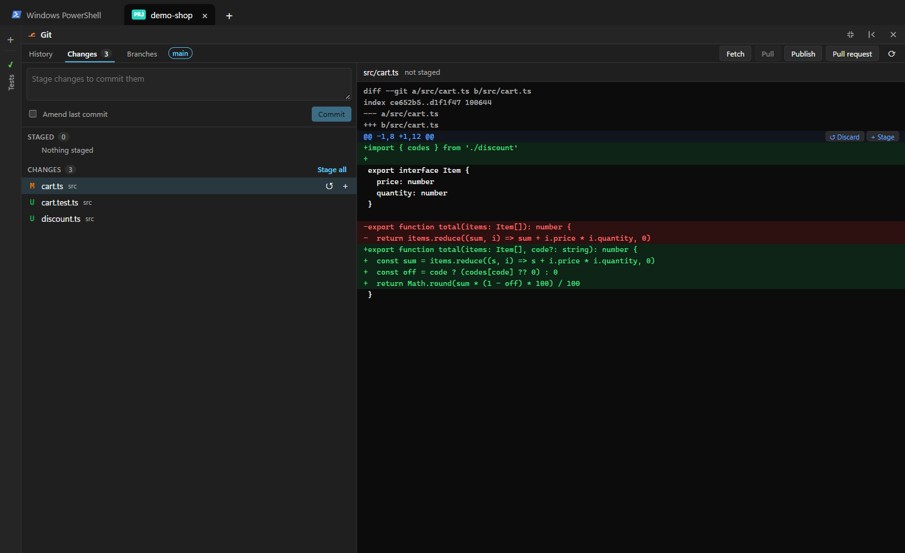
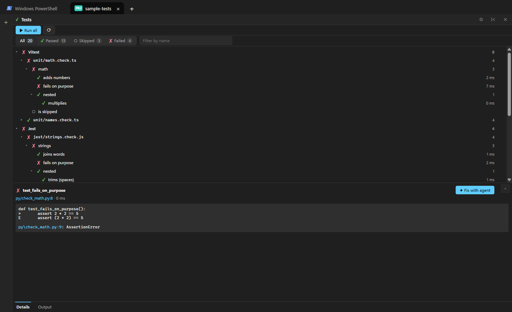
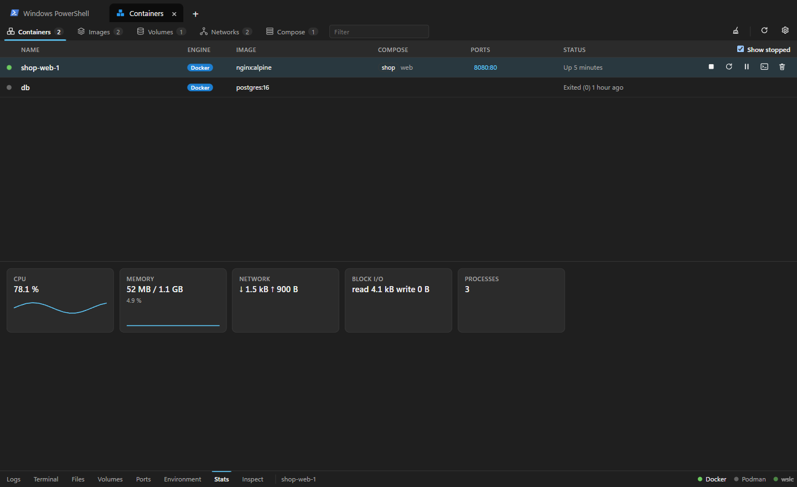
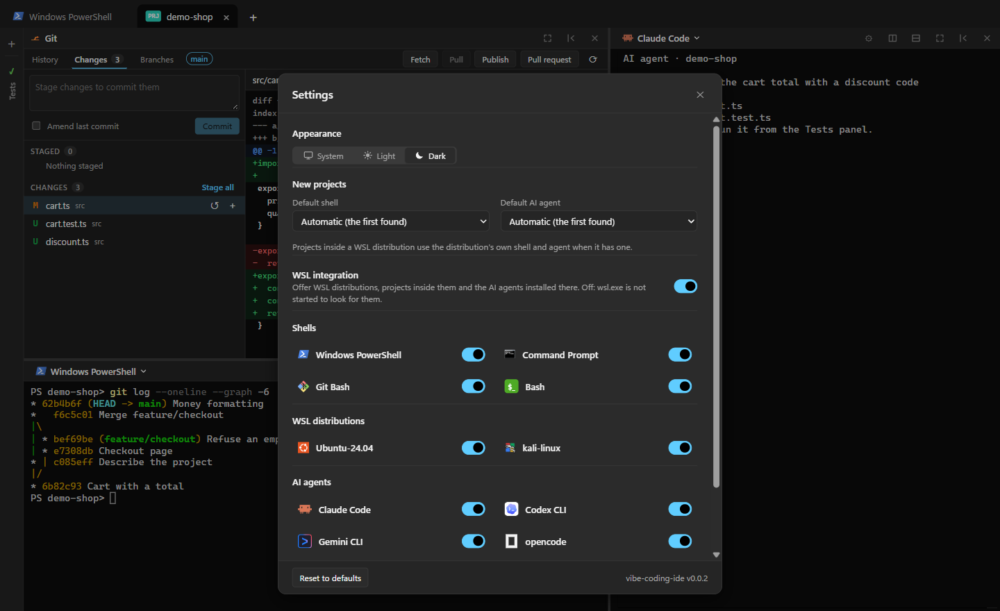

# vibe-coding-ide (prototype)

A tabbed development environment for vibe coders.

## Screenshots

A project tab: the Git history with its branch graph, a terminal and an AI agent, side by side.

| | |
|---|---|
|  |  |
| **Git changes** — stage or discard hunks and single lines (panel full screen) | **Tests** — Vitest, Jest, Playwright, pytest… a failure sent to the agent in one click |
|  |  |
| **Containers** — Docker, Podman and wslc in one view: logs, stats, a shell, files… | **Settings** — light or dark, default shell and agent, the profiles offered |

## Features

- **Every shell in tabs** — PowerShell, cmd, Git Bash and WSL distributions; drag a tab to a new window; tabs, layouts and each shell's folder come back on restart.
- **Project tabs** — Git, terminal, AI agent and tests panels side by side: split, dock, collapse, or one panel full screen.
- **AI agents** — Claude Code, Codex CLI, Gemini CLI, opencode, pi; each panel with its own MCP servers, skills and instructions.
- **Git** — history graph, staging by hunk or single line, branches, worktrees, pull requests (GitHub, GitLab…).
- **Tests** — Vitest, Jest, Playwright, pytest, Go, Rust, .NET, Java: live results; a failing test sent to the AI agent in one click.
- **Containers** — Docker, Podman and wslc in one tab: logs, live stats, a shell, files, volumes, ports, environment, images, Compose.
- **Kubernetes** — [k9s](https://k9scli.io) in a tab, the kubectl context chosen from its toolbar (Windows and WSL contexts alike).
- **WSL inside** — a project in a WSL distribution runs its git, terminal, agent and tests there.
- **Always current** — the app updates itself; pending package updates of your systems are offered in the terminal.

Every feature in detail: [docs/features.md](docs/features.md).

## Shortcuts
| Keys | Action |
|---|---|
| Ctrl+T / Ctrl+Shift+T / Ctrl+Shift+Space | Open launcher (new tab) |
| Ctrl+Shift+W | Close tab |
| Ctrl+Tab / Ctrl+Shift+Tab | Next / previous tab |
| Ctrl+Alt+1…9 | Go to tab N (9 = last) |
| Ctrl+Enter (commit message) | Commit |

**Known limits:** SSH and dev-container projects are not supported yet ([more](docs/features.md)).

Building, testing and releasing: [CONTRIBUTING.md](CONTRIBUTING.md).
